<!-- ═══════════════════════  HEADER  ═══════════════════════ -->
<p align="center">
  
</p>

<!-- ═══════════════════════  PERFIL  ═══════════════════════ -->
<p align="center">
  
  
</p>

<p align="center"></p>

<!-- ═══════════════════════  ABOUT + MUSIC  ═══════════════════════ -->
<h3 align="center">▸ 01 // ABOUT_ME</h3>

<a href="https://spotify-github-profile.kittinanx.com/api/view?uid=31mnnzo6xw64w3nrxh3nmihlygke&redirect=true" target="_blank"></a>

```bash
fabrizio@grid:~$ cat about_me.txt

> Software Engineering student
> Construyo apps y las despliego
  seguras y eficientes en la nube
> Focus ..... AWS + Cybersecurity
> Stack ..... Java · Python · Linux
> Idiomas ... ES / EN

fabrizio@grid:~$ _
```

<br clear="left"/>

<p align="center">
  <a href="https://github.com/FabrizioRodriguez-Tech" target="_blank"></a>
  <a href="https://www.linkedin.com/in/fabrizio-rodriguez-652344410" target="_blank"></a>
  <a href="https://tryhackme.com/p/Faburitsuio" target="_blank"></a>
  <a href="https://open.spotify.com/user/31mnnzo6xw64w3nrxh3nmihlygke" target="_blank"></a>
</p>

<p align="center"></p>

<!-- ═══════════════════════  STACK  ═══════════════════════ -->
<h3 align="center">▸ 02 // TECH_ARSENAL</h3>

<p align="center">
  
</p>

<p align="center"></p>

<!-- ═══════════════════════  STATS  ═══════════════════════ -->
<h3 align="center">▸ 03 // SYSTEM_STATS</h3>

<p align="center">
  
  
</p>

<p align="center">
  
</p>

<p align="center"></p>


<!-- ═══════════════════════  SNAKE  ═══════════════════════ -->
<h3 align="center">▸ 04 // CONTRIBUTION_GRID</h3>

<p align="center">
  
</p>

<!-- ═══════════════════════  FOOTER  ═══════════════════════ -->
<p align="center">
  
</p>

<p align="center">
  
</p>
